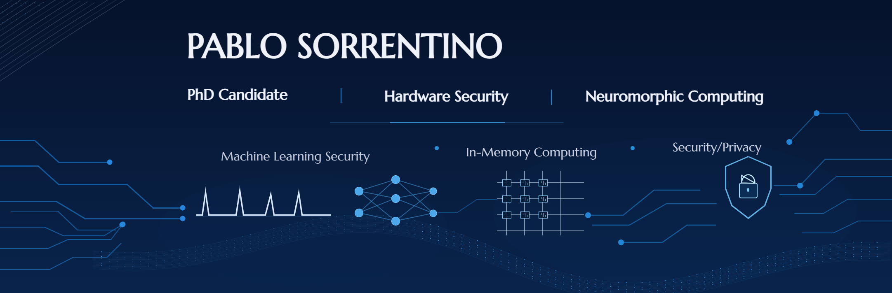

  

## About Me

I am an **Electronic Engineer and PhD researcher at the University of Groningen**, affiliated with the **Bernoulli Institute and CogniGron** in the Netherlands.

My research focuses on the intersection of **Hardware Security, Machine Learning Security, and Neuromorphic Computing**, with particular interest in the security and privacy challenges introduced by emerging computing architectures.

I work across hardware and software, investigating how novel computing technologies introduce new attack surfaces and how their security can be evaluated and improved.

My background also includes microfabrication, embedded systems, FPGA development, and low-level programming.

## Research Interests

- **Hardware Security:** Side-channel analysis, fault injection, hardware Trojans, and hardware-level countermeasures.
- **Machine Learning Security & Privacy:** Adversarial attacks, backdoor attacks, membership inference, and model inversion.
- **Neuromorphic Computing:** Spiking Neural Networks (SNNs), brain-inspired architectures, and event-driven computation.
- **Emerging Hardware:** Memristive devices, in-memory computing, and emerging memory technologies.
- **Hardware Security Primitives:** Physical Unclonable Functions (PUFs), True Random Number Generators (TRNGs), and their integration with emerging architectures.

## Research & Publications

### Emerging Threats and Countermeasures in Neuromorphic Systems: A Survey (2026)

A comprehensive survey investigating hardware and software security threats in neuromorphic and in-memory computing systems.

The work examines security challenges involving SNNs, memristive architectures, side-channel and fault attacks, adversarial machine learning, privacy attacks, and emerging hardware security primitives.

**Resources:**

- [Paper — arXiv](https://arxiv.org/abs/2601.16589)
- [Companion Repository — Security and Privacy in Neuromorphic Computing](https://github.com/SorrentinoPablo/Survey_Security_Privacy_Neuromorphic_Computing)

### Current Research Directions

My ongoing research explores security and privacy in neuromorphic systems, with an emphasis on:

- Side-channel analysis and fault injection involving SNNs and conventional computing hardware.
- Privacy and backdoor attacks in spiking neural networks.
- The intersection of memristive computing, PUFs, TRNGs, and hardware security.
- The potential of neuromorphic computing as a tool for security analysis.

---

## Engineering Projects

Before focusing on neuromorphic and hardware security research, I worked on several embedded systems, electronics, and FPGA projects.

<b>View Previous Engineering Projects</b>

### Receiver Development for Magnetic Field Sensors

Development of a data acquisition and processing system for microfabricated magnetic field sensors, using an STM32 microcontroller, DMA, and a real-time operating system (RTOS).

**Technologies:** STM32, C/C++, RTOS, DMA, Embedded Systems.

[View Repository](https://github.com/SorrentinoPablo/MTJ_Project)

---

### Home Automation System

Development of an embedded home automation system integrating temperature sensing, LED control, and motor operation through firmware and hardware design.

**Technologies:** Embedded Systems, C/C++, Sensors, Firmware.

[View Repository](https://github.com/SorrentinoPablo/HAS_Project)

---

### Temperature Sensor Integration with CAN Bus

Integration of a temperature sensor into a Controller Area Network (CAN) using an SPI-to-CAN transceiver and an STM32 Cortex-M4 microcontroller.

**Technologies:** STM32, CAN Bus, SPI, Embedded C, Firmware.

[View Repository](https://github.com/SorrentinoPablo/T-CAN_Project)

---

### Low-Level FPGA Programming for ADC Integration

Hardware-level implementation of Analog-to-Digital Converter (ADC) interfacing on an Xilinx FPGA, focusing on data acquisition, hardware integration, and energy-efficient operation.

**Technologies:** FPGA, Verilog, ADC, Digital Design.

[View Repository](https://github.com/SorrentinoPablo/FPGA_ADC_Project)

---

## Technical Background

**Programming:** Python, C/C++, VHDL, Verilog

**Hardware & Embedded Systems:** FPGA, STM32, RTOS, Microcontrollers, Digital Electronics

**Research Areas:** Neuromorphic Computing, Spiking Neural Networks, Hardware Security, Machine Learning Security, In-Memory Computing

## Contact & Academic Profiles

- **University:** University of Groningen, Netherlands
- **Research:** Bernoulli Institute / CogniGron
- **Email:** [p.f.a.sorrentino@rug.nl](mailto:p.f.a.sorrentino@rug.nl)
- **Google Scholar:** [Academic Profile](https://scholar.google.com/citations?user=QcFQKtkAAAAJ&hl=en)

I am open to research discussions and collaborations involving hardware security, neuromorphic computing, and machine learning security.
